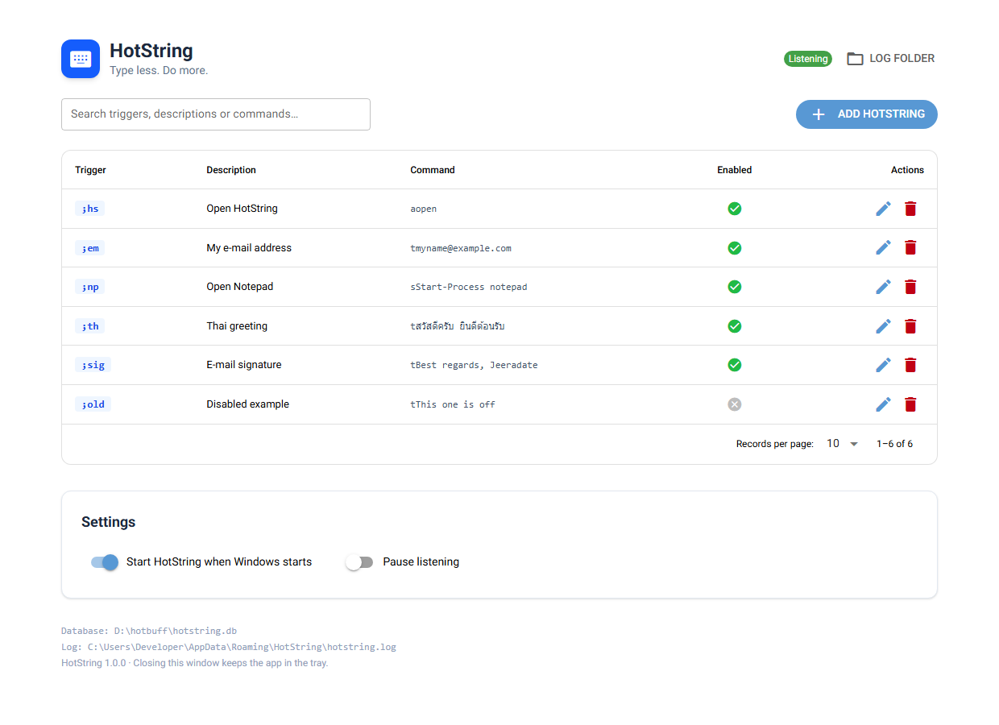
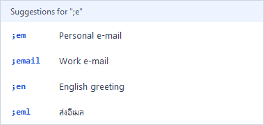

# HotString3

**Type less. Do more.**

HotString3 is a lightweight Windows text expander and command launcher. Create a short trigger
(2–8 characters, for example `;em`), type it in **any** application, and HotString3 erases it and
runs the command you attached to it — type text, launch programs with PowerShell, or open the
HotString3 window itself.

Built with Python, [NiceGUI](https://nicegui.io/) (native pywebview window), SQLModel/SQLite,
`pynput` for the global keyboard hook and `pystray` for the tray icon.




---

## Features

- **Global triggers** — works in any focused application, not just the HotString3 window.
- **Instant management** — add, edit, delete, enable or disable HotStrings; changes apply
  immediately, no restart.
- **Trigger suggestions** — typing `;` shows every available second character, and from two
  characters on a non-activating popup lists matching triggers with their descriptions while you
  keep typing.
- **Three command types** — type Unicode text, run hidden PowerShell, or trigger an app action.
- **Startup commands** — run PowerShell automatically when HotString3 starts.
- **First-run onboarding** — a guided screen creates the `;hs` → `aopen` rule for you.
- **Runs in the background** — closing the window (or **Hide to tray**) removes it from the
  taskbar while the keyboard listener and tray icon keep running.
- **Startup notification** — a non-blocking toast confirms for three seconds that the hotkey
  listener is running in the background.
- **PowerShell auto-detection** — PowerShell 7 (`pwsh`) is preferred, with Windows PowerShell
  (`powershell.exe` 5.1 or newer) as the fallback. The active executable and version are shown in
  the UI footer.
- **Live status** — the header shows **Listening**/**Paused** and the total HotString count, both
  updated in real time.
- **Clean exit** — **Settings → Quit HotString3** asks for confirmation before stopping the
  listener, tray icon and UI.
- **Lightning icon** — the same lightning mark is used for the window, taskbar button and system
  tray icon.
- **Single instance** — launching HotString3 again opens the existing instance instead of
  starting a second one.
- **Reliable Unicode typing** — Thai, emoji and multi-line text are pasted through the clipboard,
  independent of the active keyboard layout.
- **Rotating logs** — everything is written to `%APPDATA%\HotString3\hotstring3.log`.

---

## Requirements

- Windows 10 or Windows 11
- Python 3.11 or newer
- [`uv`](https://docs.astral.sh/uv/) for dependency management
- Microsoft Edge WebView2 Runtime (pre-installed on Windows 11 and most Windows 10 machines)
- PowerShell 7 (`pwsh`) and/or Windows PowerShell 5.1+ (detected automatically)

---

## Installation

```bash
git clone https://github.com/jeeradate/hotstring3.git
cd hotstring3
uv sync
uv run hotstring3
```

The first start opens the welcome screen. It explains triggers and the command format and asks
you to create your first HotString, pre-filled with:

| Field | Value |
| --- | --- |
| Trigger | `;hs` |
| Description | Open HotString3 |
| Command | `aopen` |

The **Start HotString3 when Windows starts** checkbox is checked by default.

After that, HotString3 starts silently in the system tray on every launch and shows the
three-second **“Hotkey listener is running in the background”** toast. To open the window,
double-click the tray icon or choose **Open HotString3**.

> Renaming the project folder is optional. HotString3 resolves its package and icon paths from
> the installed package, so `uv run hotstring3` works from any folder name. If you kept an older
> checkout, rename it to `hotstring3` and run `uv sync` again.

---

## Quick start

Create these HotStrings in the UI, then try them in Notepad, your browser, or any other app:

| Trigger | Command | What happens |
| --- | --- | --- |
| `;em` | `tmyname@example.com` | Types your e-mail address |
| `;np` | `sStart-Process notepad` | Opens Notepad (no console window) |
| `;hs` | `aopen` | Opens the HotString3 management window |
| `;th` | `tสวัสดีครับ` | Types Thai text (Unicode-safe) |

Type the trigger, and HotString3 removes it and runs the command. A popup also appears while you
type: `;` shows the available second characters, and from the first **two** characters it lists
the matching triggers and their descriptions.

---

## Trigger suggestions

As you type in any application, HotString3 checks whether the most recent characters are the start
of an enabled trigger. The popup has two stages:

1. **`;` (one character)** — every distinct second character found in the enabled triggers is
   listed once (`;a`, `;p`, `;g`, …) with how many rules use it, so you can see all available
   groups at a glance.
2. **`;e` (two or more characters)** — every trigger starting with those characters is shown with
   its **trigger and description only**; the command/expansion text is never displayed in the
   popup, and longer prefixes narrow the list.



The popup is designed to stay out of the way:

- It **never takes keyboard focus** — typing continues in the application underneath.
- It **filters as you type**: `;e` shows `;em`, `;email` and `;en`; `;ema` narrows the list.
- It **never truncates the list**: when the entries do not fit in one column, the popup grows
  additional columns (up to five), each holding the matching triggers or categories.
- It follows the text caret (falling back to the mouse pointer) and stays on the current monitor,
  flipping above the line near the bottom of the screen.
- It **dismisses automatically** when the trigger fires, the prefix stops matching, or you press
  Esc/Tab/Enter, an arrow/Home/End/PageUp/PageDown key, click the mouse, switch windows or pause
  listening. Clicking the popup also hides it.
- Only **enabled** HotStrings are suggested, and matching is case-sensitive.

Suggestions are display-only; the trigger still fires only when the full trigger has been typed.
If Tk is unavailable, HotString3 logs a warning and keeps working without the popup.

---

## Command format

A command is plain text. Its **first character** defines its type:

| Prefix | Type | Description | Example |
| --- | --- | --- | --- |
| `t` | Type text | Pastes text into the focused application | `tHello world` |
| `s` | PowerShell | Runs a hidden PowerShell script | `sStart-Process notepad` |
| `a` | App action | Runs a built-in HotString3 action (`aopen` opens the UI) | `aopen` |
| `r` | Startup | Runs a hidden PowerShell script when HotString3 starts | `rStart-Process notepad` |

One optional separator directly after the prefix is ignored, so all of these are equivalent:

```text
tHello
t Hello
t:Hello
```

The same applies to `s`, `a` and `r` (`s:Get-Date`). Anything after the prefix is passed through
unchanged, including newlines.

Notes:

- `t` supports **Unicode (including Thai) and multi-line text**. HotString3 temporarily puts the
  text on the clipboard, sends `Ctrl+V`, and restores the previous text clipboard.
- `s` and `r` run the script with the detected PowerShell executable, using
  `-NoProfile -WindowStyle Hidden -ExecutionPolicy Bypass -Command "<script>"` and
  `CREATE_NO_WINDOW`, on a worker thread. stdout, stderr and the exit code are logged.
- `r` commands run **once when HotString3 starts**, not every time the UI opens.
- Commands with an unknown prefix are rejected by the editor and by the database layer.
- The **Test** button in the add/edit dialog validates the command. For `t` it shows a preview
  instead of typing; for `s`/`r` it runs the script.

### PowerShell selection

At startup HotString3 looks for **PowerShell 7 (`pwsh`)** first, including the standard
`%ProgramFiles%\PowerShell\7` install location. If it is not available, it falls back to
**Windows PowerShell (`powershell.exe`) 5.1 or newer**. The version is verified by running
`$PSVersionTable.PSVersion.ToString()`.

The UI footer shows the active choice directly below the database and log paths:

```text
Database: C:\Users\you\AppData\Roaming\HotString3\hotstring3.db
Log:      C:\Users\you\AppData\Roaming\HotString3\hotstring3.log
PowerShell: 7.4.2 (pwsh)
```

---

## Using the management window

- **Search** filters by trigger, description or command.
- **Add HotString** opens the editor at the bottom of the list.
- **Edit** (pencil) and **Delete** (trash, with confirmation) appear on every row.
- **Enabled** controls whether a trigger fires. Disabled triggers stay in the list.
- The header shows **Listening** or **Paused**, plus **Total: N** for all configured HotStrings.
  The count updates when HotStrings are added, deleted or imported.
- **Settings**:
  - *Start HotString3 when Windows starts* — writes/removes the registry `Run` entry.
  - *Pause listening* — keeps the keyboard hook installed but stops matching. The header badge
    and this switch always reflect the same state, including changes made from the tray.
  - *Hide to tray* — closes the window and removes it from the taskbar while the listener and
    tray icon stay active.
  - *Quit HotString3* — asks for confirmation, then stops the background listener, closes the
    tray icon and terminates all HotString3 processes cleanly.

Validation rules in the editor:

- Trigger length 2–8, no whitespace, unique (triggers are **case-sensitive**).
- A trigger that is the suffix of another trigger produces a warning, because the shorter one
  always fires first while typing.
- The command must start with `t`, `s`, `a` or `r` and have a body.

### Tray menu

| Item | Action |
| --- | --- |
| Open HotString3 | Opens (or reopens) the management window |
| Pause listening / Resume listening | Toggles trigger matching (persisted) |
| Start with Windows | Adds/removes the registry entry (checkmark shows current state) |
| Exit | Stops the listener, tray icon and HotString3 |

Double-clicking the tray icon also restores the window. Only one instance can run; starting
HotString3 a second time signals the running instance to open its window and then exits
immediately.

---

## Background behavior

HotString3 is designed to live in the notification area:

- Closing the window with **X** only ends the UI window. The taskbar button disappears, but the
  keyboard listener and tray icon remain active.
- **Settings → Hide to tray** does the same explicitly.
- Reopen the window from the tray icon at any time.
- On startup, a small non-blocking toast appears for **3 seconds** saying
  “Hotkey listener is running in the background”, then dismisses itself.
- Exiting through **Settings → Quit HotString3** or the tray **Exit** item shuts everything down:
  the tray icon is removed, the global hook is stopped, the suggestion popup and startup notice
  are closed, and the UI process is terminated.

---

## Start with Windows

HotString3 registers itself under:

```text
HKCU\Software\Microsoft\Windows\CurrentVersion\Run
Value name: HotString3
```

The value launches `pythonw.exe -m hotstring3` (or the packaged executable), so no console window
appears at login. Toggle it from **Settings** in the UI or from the tray menu. Removing it is
immediate and requires no restart.

---

## Keyboard layout note

Matching uses **the characters actually produced by the active keyboard layout**, compared
exactly and case-sensitively.

- A trigger typed with the English layout will not match while the Thai layout is active.
- `;EM` and `;em` are different triggers.
- Dead keys, IME composition and AltGr characters behave as typed on your layout.

The buffer is cleared on Enter, Esc, Tab, arrow keys, Home/End, PageUp/PageDown, mouse clicks and
window focus changes, so stale characters cannot trigger anything.

---

## Security warning

> **`s` and `r` commands run PowerShell with your Windows user permissions.**
>
> HotString3 does not sandbox, sign or review commands. A malicious or careless command can delete
> files, change settings, download software or exfiltrate data. Only add commands you understand
> and trust, keep your database file private, and never import HotStrings from an untrusted source.
> Commands run with your normal permissions — not elevated — so they cannot silently administer
> the machine unless you run HotString3 as administrator.

The keyboard hook also sees everything you type. HotString3 does not record or transmit keystrokes;
only the last eight characters are held in memory to detect triggers, and the database and logs
stay on your PC.

---

## Data locations

| What | Path |
| --- | --- |
| Database | `%APPDATA%\HotString3\hotstring3.db` (created automatically, including the folder) |
| Log | `%APPDATA%\HotString3\hotstring3.log` (2 MB rotating, 3 backups) |
| Settings | `%APPDATA%\HotString3\settings.json` |

On the first start after upgrading, HotString3 copies an existing
`%APPDATA%\HotString\hotstring.db`, log and settings into the new folder if the new folder does
not exist yet. Existing files are never overwritten, so the migration can safely be retried.

Environment overrides are available for development and testing. The `HOTSTRING3_` prefix is
preferred; the older `HOTSTRING_` names remain supported as aliases:

| Variable | Effect |
| --- | --- |
| `HOTSTRING3_DATA_DIR` | Moves the database, log and settings to another folder |
| `HOTSTRING3_DB` | Uses an explicit database file (highest priority) |
| `HOTSTRING3_SETTINGS` | Uses an explicit settings file |
| `HOTSTRING3_LOG` | Uses an explicit log file |
| `HOTSTRING3_APP_DIR` | Older alias for `HOTSTRING3_DATA_DIR` |
| `HOTSTRING3_NO_POPUP` | Disables the suggestion popup and startup toast |
| `HOTSTRING3_NO_NATIVE` | Serves the UI in a browser instead of a native window |
| `HOTSTRING3_UI_PORT` | Uses a fixed local port for the UI server |

### Loading HotStrings into the database

The UI writes every change to `%APPDATA%\HotString3\hotstring3.db` immediately and signals the
running listener, so new triggers work without a restart. The onboarding screen uses the same
upsert path, so submitting it twice cannot create duplicate triggers.

For scripted or repeatable loads, use the idempotent seed API. Triggers are the unique key;
validation is applied before writing, invalid entries are skipped, and existing rules are left
alone unless you ask for an update:

```python
from hotstring3 import config, db
from hotstring3.db import SeedEntry

config.ensure_dirs()
db.init_db()

result = db.seed_hotstrings([
    SeedEntry(";em", "Personal e-mail", "tme@example.com"),
    SeedEntry(";np", "Notepad", "sStart-Process notepad"),
])
print(result.created, result.skipped)
```

Pass `update_existing=True` to overwrite rules with the same trigger. After seeding from a
separate process, call `hotstring3.signals.signal_reload()` so the running listener picks the new
triggers up immediately; the management UI does this for you.

---

## Troubleshooting

- **A trigger does not fire.** Check that listening is not paused, the HotString is enabled, the
  trigger is not a suffix of another trigger, and the keyboard layout matches. Some elevated
  windows and games using raw input do not accept synthetic input; run HotString3 at the same
  privilege level if needed.
- **The suggestion popup does not appear.** It needs a typed `;` (or another non-alphanumeric
  leading character) that starts an enabled trigger, and listening must not be paused. Cases where the target app does not expose a
  caret position still get a popup near the mouse pointer. Full-screen exclusive games may draw
  over it; triggers themselves continue to work.
- **Nothing is typed for a `t` command.** Make sure the target control accepts `Ctrl+V`. The
  clipboard is restored to its previous text after pasting; non-text clipboard content may be
  replaced.
- **The window does not open.** Check that WebView2 is installed. Logs are in
  `%APPDATA%\HotString3\hotstring3.log`; the tray menu can open the log folder.
- **PowerShell fails.** Open the log to see the detected executable, stdout, stderr and the exit
  code. Test the same script manually with `pwsh -NoProfile -Command "<script>"` or
  `powershell.exe -NoProfile -Command "<script>"`.
- **The taskbar icon is gone but hotkeys still work.** That is expected after closing the window
  or choosing **Hide to tray**. Use the tray icon to reopen it.
- **Two copies seem to run.** Only one background instance is allowed; a second launch asks the
  first instance to show its window.

---

## Project structure

```text
hotstring3/
├── pyproject.toml
├── uv.lock
├── README.md
├── LICENSE
├── .gitignore
├── assets/
│   └── lightning.ico        # window, taskbar and tray icon
├── src/hotstring3/
│   ├── __init__.py
│   ├── __main__.py          # uv run hotstring3 / python -m hotstring3
│   ├── app.py               # startup, single instance, process orchestration
│   ├── background_notice.py # 3-second startup toast
│   ├── icon.py              # lightning icon loading/generation
│   ├── models.py            # SQLModel HotString model and validation helpers
│   ├── db.py                # engine, session, CRUD, counts, seed/upsert
│   ├── listener.py          # global keyboard hook, rolling buffer and suggestions
│   ├── suggestions.py       # pure trigger-prefix lookup for the popup
│   ├── suggestion_popup.py  # non-activating Tk popup window
│   ├── executor.py          # t / s / a / r parsing and execution
│   ├── powershell.py        # PowerShell 7 / 5.1 detection and version reporting
│   ├── ui.py                # NiceGUI pages, dialogs, status and settings
│   ├── tray.py              # pystray icon and menu
│   ├── autostart.py         # registry Run key
│   ├── signals.py           # Windows named events between processes
│   └── config.py            # paths, constants, settings, logging
└── tests/
    ├── test_models.py
    ├── test_matching.py
    ├── test_suggestions.py
    ├── test_config.py
    └── test_executor.py
```

---

## Development

```bash
uv sync                 # create the environment and install dependencies
uv run pytest           # run the test suite
uv run hotstring3       # start the app
```

To capture screenshots or develop without opening a native window, set
`HOTSTRING3_NO_NATIVE=1`; the UI then serves in a browser instead of pywebview.

---

## Known limitations

- Windows only (registry autostart, `pynput` hook, Win32 clipboard).
- Triggers are limited to 8 characters and are matched case-sensitively per keyboard layout.
- Typing support relies on clipboard paste, so clipboard history tools may record the pasted
  text and non-text clipboard contents are not restored.
- PowerShell output is decoded as UTF-8; scripts that emit text in the OEM code page may show
  replacement characters in the log.
- Elevated applications may ignore simulated input unless HotString3 is elevated too.
- The suggestion popup and startup toast are Windows-only (Tk + Win32). Applications that do not
  report a text caret get a popup near the mouse pointer instead of at the insertion point.

---

## License

MIT — see [LICENSE](LICENSE).
