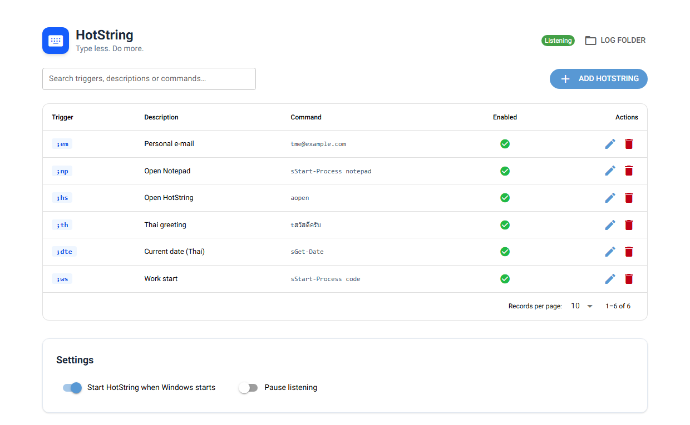
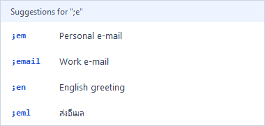

# HotString3

**พิมพ์น้อยลง ทำได้มากขึ้น**

HotString3 คือโปรแกรมขยายข้อความ (text expander) และตัวเรียกคำสั่งสำหรับ Windows ที่มีขนาดเบา
สร้างตัวเรียก (trigger) สั้น ๆ (2–8 ตัวอักษร เช่น `;em`) พิมพ์มันใน **แอปพลิเคชันใดก็ได้**
แล้ว HotString3 จะลบตัวเรียกนั้นออกและรันคำสั่งที่คุณผูกไว้ — พิมพ์ข้อความ เปิดโปรแกรมด้วย
PowerShell หรือเปิดหน้าต่าง HotString3 เอง

สร้างด้วย Python, [NiceGUI](https://nicegui.io/) (หน้าต่าง pywebview แบบเนทีฟ), SQLModel/SQLite,
`pynput` สำหรับดักคีย์บอร์ดทั้งระบบ และ `pystray` สำหรับไอคอนในถาดระบบ




---

## คุณสมบัติ

- **ตัวเรียกทั้งระบบ** — ทำงานในแอปพลิเคชันที่กำลังโฟกัสอยู่ ไม่จำกัดเฉพาะหน้าต่าง HotString3
- **จัดการได้ทันที** — เพิ่ม แก้ไข ลบ เปิด/ปิดการใช้งาน HotString; การเปลี่ยนแปลงมีผลทันที
  ไม่ต้องรีสตาร์ต
- **แนะนำตัวเรียก** — เมื่อพิมพ์ครบสองตัวอักษร จะมีป๊อปอัปที่ไม่แย่งโฟกัสแสดงตัวเรียกและคำอธิบาย
  ที่ตรงกัน ขณะที่คุณพิมพ์ต่อ
- **คำสั่งสามประเภท** — พิมพ์ข้อความ Unicode, รัน PowerShell แบบซ่อนหน้าต่าง หรือเรียกคำสั่งของแอป
- **คำสั่งตอนเริ่มระบบ** — รัน PowerShell อัตโนมัติเมื่อ HotString3 เริ่มทำงาน
- **แนะนำครั้งแรก** — หน้าจอแบบมีขั้นตอนจะสร้างกฎ `;hs` → `aopen` ให้คุณ
- **ทำงานเบื้องหลัง** — การปิดหน้าต่าง (หรือ **Hide to tray**) จะเอาไอคอนออกจากทาสก์บาร์
  แต่ตัวดักคีย์บอร์ดและไอคอนถาดระบบยังทำงานต่อ
- **แจ้งเตือนตอนเริ่ม** — การแจ้งเตือนแบบไม่บล็อกยืนยัน 3 วินาทีว่าตัวดักคีย์บอร์ดกำลังทำงานเบื้องหลัง
- **ตรวจจับ PowerShell อัตโนมัติ** — ใช้ PowerShell 7 (`pwsh`) ก่อน และถ้าไม่มีจะใช้
  Windows PowerShell (`powershell.exe` 5.1 ขึ้นไป) โดยแสดงไฟล์ที่ใช้และเวอร์ชันที่ส่วนท้ายของ UI
- **สถานะสด** — ส่วนหัวแสดง **Listening**/**Paused** และจำนวน HotString ทั้งหมด อัปเดตแบบเรียลไทม์
- **ออกอย่างสะอาด** — **Settings → Quit HotString3** จะถามยืนยันก่อนหยุดตัวดักคีย์บอร์ด
  ไอคอนถาดระบบ และ UI
- **ไอคอนสายฟ้า** — ใช้ไอคอนสายฟ้าเดียวกันทั้งหน้าต่าง ปุ่มทาสก์บาร์ และถาดระบบ
- **อินสแตนซ์เดียว** — เปิด HotString3 ซ้ำจะเป็นการเปิดหน้าต่างของอินสแตนซ์ที่ทำงานอยู่แทน
- **พิมพ์ Unicode ได้น่าเชื่อถือ** — ภาษาไทย อีโมจิ และข้อความหลายบรรทัดถูกวางผ่านคลิปบอร์ด
  โดยไม่ขึ้นกับเลย์เอาต์คีย์บอร์ดที่ใช้งานอยู่
- **ล็อกแบบหมุนเวียน** — ทุกอย่างถูกบันทึกไว้ที่ `%APPDATA%\HotString3\hotstring3.log`

---

## สิ่งที่ต้องมี

- Windows 10 หรือ Windows 11
- Python 3.11 ขึ้นไป
- [`uv`](https://docs.astral.sh/uv/) สำหรับจัดการ dependencies
- Microsoft Edge WebView2 Runtime (ติดตั้งมาพร้อม Windows 11 และ Windows 10 ส่วนใหญ่)
- PowerShell 7 (`pwsh`) และ/หรือ Windows PowerShell 5.1+ (ตรวจจับอัตโนมัติ)

---

## การติดตั้ง

```bash
git clone https://github.com/jeeradate/hotstring3.git
cd hotstring3
uv sync
uv run hotstring3
```

การเริ่มครั้งแรกจะเปิดหน้าจอต้อนรับ ซึ่งอธิบายเรื่องตัวเรียกและรูปแบบคำสั่ง และให้คุณสร้าง
HotString ตัวแรก โดยกรอกค่าไว้ล่วงหน้าเป็น:

| ช่อง | ค่า |
| --- | --- |
| Trigger | `;hs` |
| Description | Open HotString3 |
| Command | `aopen` |

ช่อง **Start HotString3 when Windows starts** ถูกเลือกไว้เป็นค่าเริ่มต้น

หลังจากนั้น HotString3 จะเริ่มทำงานเงียบ ๆ ในถาดระบบทุกครั้งที่เปิด และแสดงข้อความ
**“Hotkey listener is running in the background”** เป็นเวลา 3 วินาที หากต้องการเปิดหน้าต่าง
ให้ดับเบิลคลิกไอคอนในถาดระบบ หรือเลือก **Open HotString3**

> การเปลี่ยนชื่อโฟลเดอร์โปรเจกต์ไม่บังคับ HotString3 หาแพ็กเกจและไอคอนจากแพ็กเกจที่ติดตั้ง
> ดังนั้น `uv run hotstring3` ทำงานได้จากโฟลเดอร์ชื่ออะไรก็ได้ หากคุณยังมีสำเนาเก่า
> ให้เปลี่ยนชื่อเป็น `hotstring3` แล้วรัน `uv sync` อีกครั้ง

---

## เริ่มต้นอย่างรวดเร็ว

สร้าง HotString เหล่านี้ใน UI แล้วลองใช้ใน Notepad เบราว์เซอร์ หรือแอปอื่น ๆ:

| ตัวเรียก | คำสั่ง | เกิดอะไรขึ้น |
| --- | --- | --- |
| `;em` | `tmyname@example.com` | พิมพ์ที่อยู่อีเมลของคุณ |
| `;np` | `sStart-Process notepad` | เปิด Notepad (ไม่มีหน้าต่างคอนโซล) |
| `;hs` | `aopen` | เปิดหน้าต่างจัดการ HotString3 |
| `;th` | `tสวัสดีครับ` | พิมพ์ข้อความภาษาไทย (รองรับ Unicode) |

พิมพ์ตัวเรียก แล้ว HotString3 จะลบมันออกและรันคำสั่ง หลังจากคุณพิมพ์สองตัวอักษรแรกของ
ตัวเรียก ป๊อปอัปจะแสดงตัวเรียกที่ตรงกันพร้อมคำอธิบายด้วย

---

## การแนะนำตัวเรียก

ขณะที่คุณพิมพ์ในแอปใดก็ได้ HotString3 จะตรวจว่าตัวอักษรล่าสุดเป็นจุดเริ่มต้นของตัวเรียกที่
เปิดใช้งานอยู่หรือไม่ เมื่อคำนำหน้านั้นยาวอย่างน้อยสองตัวอักษร (เช่น `;e`) ป๊อปอัปเล็ก ๆ
จะปรากฏขึ้นพร้อมตัวเรียกที่ตรงกันทั้งหมดและคำอธิบาย:



ป๊อปอัปถูกออกแบบมาให้ไม่รบกวน:

- **ไม่แย่งโฟกัสคีย์บอร์ด** — การพิมพ์ยังดำเนินต่อในแอปพลิเคชันด้านล่าง
- **กรองตามที่พิมพ์**: `;e` แสดง `;em`, `;email` และ `;en`; `;ema` ทำให้รายการแคบลง
- ตำแหน่งตามเคอร์เซอร์ข้อความ (ถ้าหาไม่ได้จะใช้ตำแหน่งเมาส์) และอยู่ในจอภาพเดิม
  โดยจะพลิกขึ้นด้านบนเมื่อใกล้ขอบล่างของจอ
- **ปิดตัวเองอัตโนมัติ** เมื่อตัวเรียกทำงาน คำนำหน้าไม่ตรงอีกต่อไป หรือคุณกด Esc/Tab/Enter
  ปุ่มลูกศร/Home/End/PageUp/PageDown คลิกเมาส์ สลับหน้าต่าง หรือหยุดฟังชั่วคราว
  การคลิกที่ป๊อปอัปก็ซ่อนมันเช่นกัน
- แนะนำเฉพาะ HotString ที่ **เปิดใช้งาน** และการจับคู่แยกตัวพิมพ์เล็ก–ใหญ่

การแนะนำมีไว้เพื่อแสดงผลเท่านั้น ตัวเรียกจะทำงานเมื่อพิมพ์ตัวเรียกครบเท่านั้น
หาก Tk ไม่พร้อมใช้งาน HotString3 จะบันทึกคำเตือนและทำงานต่อโดยไม่มีป๊อปอัป

---

## รูปแบบคำสั่ง

คำสั่งคือข้อความธรรมดา **ตัวอักษรตัวแรก** กำหนดประเภทของมัน:

| คำนำหน้า | ประเภท | คำอธิบาย | ตัวอย่าง |
| --- | --- | --- | --- |
| `t` | พิมพ์ข้อความ | วางข้อความลงในแอปที่กำลังโฟกัส | `tHello world` |
| `s` | PowerShell | รันสคริปต์ PowerShell แบบซ่อนหน้าต่าง | `sStart-Process notepad` |
| `a` | คำสั่งแอป | รันคำสั่งในตัวของ HotString3 (`aopen` เปิด UI) | `aopen` |
| `r` | ตอนเริ่มระบบ | รันสคริปต์ PowerShell แบบซ่อนหน้าต่างเมื่อ HotString3 เริ่มทำงาน | `rStart-Process notepad` |

ตัวคั่นหนึ่งตัวที่อยู่ติดหลังคำนำหน้าจะถูกมองข้าม ดังนั้นทั้งหมดนี้เทียบเท่ากัน:

```text
tHello
t Hello
t:Hello
```

หลักการเดียวกันใช้กับ `s`, `a` และ `r` (`s:Get-Date`) ข้อความหลังคำนำหน้าจะถูกส่งต่อไปตามเดิม
รวมถึงการขึ้นบรรทัดใหม่

หมายเหตุ:

- `t` รองรับ **Unicode (รวมภาษาไทย) และข้อความหลายบรรทัด** HotString3 จะใส่ข้อความลง
  คลิปบอร์ดชั่วคราว ส่ง `Ctrl+V` แล้วคืนข้อความเดิมในคลิปบอร์ด
- `s` และ `r` รันสคริปต์ด้วย PowerShell ที่ตรวจพบ โดยใช้
  `-NoProfile -WindowStyle Hidden -ExecutionPolicy Bypass -Command "<script>"` และ
  `CREATE_NO_WINDOW` บนเธรดงานเบื้องหลัง stdout, stderr และรหัสออกจะถูกบันทึกในล็อก
- คำสั่ง `r` จะทำงาน **ครั้งเดียวเมื่อ HotString3 เริ่มทำงาน** ไม่ใช่ทุกครั้งที่เปิด UI
- คำสั่งที่คำนำหน้าไม่รู้จักจะถูกปฏิเสธโดยตัวแก้ไขและโดยชั้นฐานข้อมูล
- ปุ่ม **Test** ในกล่องเพิ่ม/แก้ไขจะตรวจสอบคำสั่ง สำหรับ `t` จะแสดงตัวอย่างแทนการพิมพ์
  ส่วน `s`/`r` จะรันสคริปต์จริง

### การเลือก PowerShell

ตอนเริ่ม HotString3 จะมองหา **PowerShell 7 (`pwsh`)** ก่อน รวมถึงตำแหน่งติดตั้งมาตรฐาน
`%ProgramFiles%\PowerShell\7` ถ้าไม่มี จะใช้ **Windows PowerShell (`powershell.exe`) 5.1 ขึ้นไป**
เวอร์ชันตรวจสอบได้ด้วยการรัน `$PSVersionTable.PSVersion.ToString()`

ส่วนท้ายของ UI แสดงตัวเลือกที่ใช้งานจริงต่อจากเส้นทางฐานข้อมูลและล็อก:

```text
Database: C:\Users\you\AppData\Roaming\HotString3\hotstring3.db
Log:      C:\Users\you\AppData\Roaming\HotString3\hotstring3.log
PowerShell: 7.4.2 (pwsh)
```

---

## การใช้หน้าต่างจัดการ

- **Search** กรองตามตัวเรียก คำอธิบาย หรือคำสั่ง
- **Add HotString** เปิดตัวแก้ไขที่ด้านล่างของรายการ
- **Edit** (ดินสอ) และ **Delete** (ถังขยะ พร้อมยืนยัน) แสดงในทุกแถว
- **Enabled** ควบคุมว่าตัวเรียกจะทำงานหรือไม่ ตัวเรียกที่ปิดใช้งานยังอยู่ในรายการ
- ส่วนหัวแสดง **Listening** หรือ **Paused** พร้อม **Total: N** สำหรับ HotString ทั้งหมด
  จำนวนจะอัปเดตเมื่อเพิ่ม ลบ หรือนำเข้า HotString
- **Settings**:
  - *Start HotString3 when Windows starts* — เขียน/ลบรายการ `Run` ในรีจิสทรี
  - *Pause listening* — ยังติดตั้งฮุกคีย์บอร์ดไว้แต่หยุดการจับคู่ สถานะบนส่วนหัวและสวิตช์นี้
    สะท้อนสถานะเดียวกันเสมอ รวมถึงเมื่อเปลี่ยนจากถาดระบบ
  - *Hide to tray* — ปิดหน้าต่างและเอาไอคอนออกจากทาสก์บาร์ โดยตัวฟังและไอคอนถาดระบบยังทำงาน
  - *Quit HotString3* — ถามยืนยัน แล้วหยุดตัวฟังเบื้องหลัง ปิดไอคอนถาดระบบ และสิ้นสุด
    โปรเซส HotString3 ทั้งหมดอย่างสะอาด

กฎการตรวจสอบในตัวแก้ไข:

- ความยาวตัวเรียก 2–8 ตัวอักษร ไม่มีช่องว่าง และไม่ซ้ำ (ตัวเรียก **แยกตัวพิมพ์เล็ก–ใหญ่**)
- ตัวเรียกที่เป็นส่วนท้ายของตัวเรียกอื่นจะแสดงคำเตือน เพราะตัวที่สั้นกว่าจะทำงานก่อนเสมอ
  ระหว่างการพิมพ์
- คำสั่งต้องขึ้นต้นด้วย `t`, `s`, `a` หรือ `r` และต้องมีเนื้อหา

### เมนูถาดระบบ

| รายการ | การทำงาน |
| --- | --- |
| Open HotString3 | เปิด (หรือเปิดใหม่) หน้าต่างจัดการ |
| Pause listening / Resume listening | สลับการจับคู่ตัวเรียก (บันทึกไว้) |
| Start with Windows | เพิ่ม/ลบรายการในรีจิสทรี (เครื่องหมายถูกแสดงสถานะปัจจุบัน) |
| Exit | หยุดตัวฟัง ไอคอนถาดระบบ และ HotString3 |

ดับเบิลคลิกไอคอนถาดระบบก็เปิดหน้าต่างกลับมาได้เช่นกัน ทำงานได้เพียงอินสแตนซ์เดียว
การเปิด HotString3 ซ้ำจะส่งสัญญาณให้อินสแตนซ์ที่ทำงานอยู่เปิดหน้าต่าง แล้วออกทันที

---

## การทำงานเบื้องหลัง

HotString3 ถูกออกแบบให้อยู่ในบริเวณแจ้งเตือน (notification area):

- การปิดหน้าต่างด้วย **X** จะจบเพียงหน้าต่าง UI ปุ่มทาสก์บาร์หายไป แต่ตัวดักคีย์บอร์ดและ
  ไอคอนถาดระบบยังทำงานอยู่
- **Settings → Hide to tray** ทำแบบเดียวกันอย่างชัดเจน
- เปิดหน้าต่างกลับได้ทุกเมื่อจากไอคอนถาดระบบ
- ตอนเริ่มทำงาน จะมีการแจ้งเตือนเล็ก ๆ แบบไม่บล็อกเป็นเวลา **3 วินาที** ว่า
  “Hotkey listener is running in the background” แล้วปิดตัวเอง
- การออกผ่าน **Settings → Quit HotString3** หรือรายการ **Exit** ในถาดระบบจะปิดทุกอย่าง:
  ไอคอนถาดระบบถูกลบ ฮุกทั้งระบบถูกหยุด ป๊อปอัปแนะนำและข้อความตอนเริ่มถูกปิด
  และโปรเซส UI ถูกสิ้นสุด

---

## เริ่มพร้อม Windows

HotString3 ลงทะเบียนตัวเองที่:

```text
HKCU\Software\Microsoft\Windows\CurrentVersion\Run
Value name: HotString3
```

ค่านั้นเปิด `pythonw.exe -m hotstring3` (หรือไฟล์ .exe ที่แพ็กแล้ว) จึงไม่มีหน้าต่างคอนโซล
ตอนล็อกอิน สลับได้จาก **Settings** ใน UI หรือจากเมนูถาดระบบ การลบมีผลทันทีโดยไม่ต้องรีสตาร์ต

---

## หมายเหตุเรื่องเลย์เอาต์คีย์บอร์ด

การจับคู่ใช้ **ตัวอักษรที่เกิดจากเลย์เอาต์คีย์บอร์ดที่ใช้งานจริง** เปรียบเทียบแบบตรงตัวและ
แยกตัวพิมพ์เล็ก–ใหญ่

- ตัวเรียกที่พิมพ์ด้วยเลย์เอาต์อังกฤษจะไม่ตรงกันขณะเปิดเลย์เอาต์ไทย
- `;EM` และ `;em` เป็นตัวเรียกที่แตกต่างกัน
- Dead key, การประกอบตัวอักษรด้วย IME และอักขระ AltGr ทำงานตามที่พิมพ์บนเลย์เอาต์ของคุณ

บัฟเฟอร์จะถูกล้างเมื่อกด Enter, Esc, Tab, ปุ่มลูกศร, Home/End, PageUp/PageDown, คลิกเมาส์
และการเปลี่ยนหน้าต่างที่โฟกัส ตัวอักษรเก่าจึงไปกระตุ้นอะไรไม่ได้

---

## คำเตือนด้านความปลอดภัย

> **คำสั่ง `s` และ `r` รัน PowerShell ด้วยสิทธิ์ผู้ใช้ Windows ของคุณ**
>
> HotString3 ไม่ได้แยกแยะ (sandbox) ลงนาม หรือตรวจสอบคำสั่ง คำสั่งที่เป็นอันตรายหรือประมาท
> สามารถลบไฟล์ เปลี่ยนการตั้งค่า ดาวน์โหลดซอฟต์แวร์ หรือขโมยข้อมูลได้ เพิ่มเฉพาะคำสั่งที่คุณ
> เข้าใจและไว้วางใจ เก็บไฟล์ฐานข้อมูลเป็นความลับ และอย่านำเข้าตัวเรียกจากแหล่งที่ไม่น่าเชื่อถือ
> คำสั่งรันด้วยสิทธิ์ปกติของคุณ — ไม่ได้ยกระดับ (elevated) — จึงจัดการเครื่องแบบเงียบ ๆ ไม่ได้
> เว้นแต่คุณจะรัน HotString3 ในฐานะผู้ดูแลระบบ

ฮุกคีย์บอร์ดยังเห็นทุกอย่างที่คุณพิมพ์ HotString3 ไม่ได้บันทึกหรือส่งต่อคีย์สโตรก
มีเพียง 8 ตัวอักษรล่าสุดที่เก็บในหน่วยความจำเพื่อตรวจจับตัวเรียก และฐานข้อมูลกับล็อก
อยู่บนเครื่องของคุณเท่านั้น

---

## ตำแหน่งข้อมูล

| อะไร | เส้นทาง |
| --- | --- |
| ฐานข้อมูล | `%APPDATA%\HotString3\hotstring3.db` (สร้างอัตโนมัติ รวมถึงโฟลเดอร์) |
| ล็อก | `%APPDATA%\HotString3\hotstring3.log` (หมุนเวียนที่ 2 MB, สำรอง 3 ไฟล์) |
| การตั้งค่า | `%APPDATA%\HotString3\settings.json` |

ในการเริ่มครั้งแรกหลังอัปเกรด HotString3 จะคัดลอก
`%APPDATA%\HotString\hotstring.db`, ล็อก และการตั้งค่าเดิมไปยังโฟลเดอร์ใหม่
หากโฟลเดอร์ใหม่ยังไม่มี ไฟล์ที่มีอยู่จะไม่ถูกเขียนทับ การย้ายข้อมูลจึงลองซ้ำได้อย่างปลอดภัย
นอกจากนี้ กฎจากฐานข้อมูลเดิมที่ยังไม่มีในฐานข้อมูลใหม่จะถูกนำเข้าให้ครั้งเดียว
(ไม่เขียนทับหรือลบกฎที่คุณมีอยู่แล้ว)

ตัวแปรสภาพแวดล้อมสำหรับการพัฒนาและทดสอบมีให้ใช้ โดยใช้คำนำหน้า `HOTSTRING3_`
เป็นหลัก และชื่อเก่า `HOTSTRING_` ยังใช้ได้ในฐานะชื่อแทน:

| ตัวแปร | ผล |
| --- | --- |
| `HOTSTRING3_DATA_DIR` | ย้ายฐานข้อมูล ล็อก และการตั้งค่าไปยังโฟลเดอร์อื่น |
| `HOTSTRING3_DB` | ใช้ไฟล์ฐานข้อมูลที่ระบุ (สำคัญสูงสุด) |
| `HOTSTRING3_SETTINGS` | ใช้ไฟล์การตั้งค่าที่ระบุ |
| `HOTSTRING3_LOG` | ใช้ไฟล์ล็อกที่ระบุ |
| `HOTSTRING3_APP_DIR` | ชื่อแทนเก่าของ `HOTSTRING3_DATA_DIR` |
| `HOTSTRING3_NO_POPUP` | ปิดป๊อปอัปแนะนำและข้อความตอนเริ่ม |
| `HOTSTRING3_NO_NATIVE` | แสดง UI ในเบราว์เซอร์แทนหน้าต่างเนทีฟ |
| `HOTSTRING3_UI_PORT` | ใช้พอร์ตคงที่สำหรับเซิร์ฟเวอร์ UI |

### การโหลด HotString เข้าสู่ฐานข้อมูล

UI เขียนทุกการเปลี่ยนแปลงลง `%APPDATA%\HotString3\hotstring3.db` ทันทีและส่งสัญญาณให้
ตัวฟังที่ทำงานอยู่ ตัวเรียกใหม่จึงใช้งานได้โดยไม่ต้องรีสตาร์ต หน้าจอแนะนำใช้เส้นทาง upsert
เดียวกัน การกดส่งซ้ำจึงสร้างตัวเรียกซ้ำไม่ได้

สำหรับการโหลดแบบสคริปต์หรือทำซ้ำได้ ให้ใช้ Seed API ที่ทำงานซ้ำได้ (idempotent)
ตัวเรียกคือคีย์ไม่ซ้ำ มีการตรวจสอบก่อนเขียน รายการที่ไม่ถูกต้องจะถูกข้าม และกฎที่มีอยู่
จะไม่ถูกแตะต้องเว้นแต่คุณจะขอให้อัปเดต:

```python
from hotstring3 import config, db
from hotstring3.db import SeedEntry

config.ensure_dirs()
db.init_db()

result = db.seed_hotstrings([
    SeedEntry(";em", "Personal e-mail", "tme@example.com"),
    SeedEntry(";np", "Notepad", "sStart-Process notepad"),
])
print(result.created, result.skipped)
```

ส่ง `update_existing=True` เพื่อเขียนทับกฎที่มีตัวเรียกเดียวกัน หลังจาก seed จากโปรเซสแยก
ให้เรียก `hotstring3.signals.signal_reload()` เพื่อให้ตัวฟังที่ทำงานอยู่รับตัวเรียกใหม่ทันที
UI ของ HotString3 ทำให้คุณอัตโนมัติอยู่แล้ว

---

## การแก้ปัญหา

- **ตัวเรียกไม่ทำงาน** ตรวจว่าการฟังไม่ได้หยุดชั่วคราว HotString เปิดใช้งานอยู่ ตัวเรียกไม่ใช่
  ส่วนท้ายของตัวเรียกอื่น และเลย์เอาต์คีย์บอร์ดตรงกัน หน้าต่างที่ยกระดับสิทธิ์และเกมที่ใช้
  raw input บางตัวไม่รับอินพุตจำลอง ให้รัน HotString3 ด้วยระดับสิทธิ์เดียวกันหากจำเป็น
- **ป๊อปอัปแนะนำไม่ปรากฏ** ต้องพิมพ์อย่างน้อยสองตัวอักษรที่เป็นคำนำหน้าของตัวเรียกที่เปิดใช้งาน
  และการฟังต้องไม่หยุดชั่วคราว กรณีที่แอปเป้าหมายไม่บอกตำแหน่งเคอร์เซอร์ ป๊อปอัปจะแสดง
  ใกล้เมาส์แทน เกมแบบ full-screen exclusive อาจวาดทับ แต่ตัวเรียกยังทำงานได้
- **คำสั่ง `t` ไม่พิมพ์อะไรเลย** ตรวจว่าคอนโทรลเป้าหมายรับ `Ctrl+V` ได้ คลิปบอร์ดจะถูกคืนค่า
  เป็นข้อความเดิมหลังวาง เนื้อหาที่ไม่ใช่ข้อความอาจถูกแทนที่
- **หน้าต่างไม่เปิด** ตรวจว่าติดตั้ง WebView2 แล้ว ล็อกอยู่ที่
  `%APPDATA%\HotString3\hotstring3.log` เมนูถาดระบบเปิดโฟลเดอร์ล็อกได้
- **PowerShell ล้มเหลว** เปิดล็อกเพื่อดูไฟล์ที่ตรวจพบ stdout, stderr และรหัสออก
  ทดสอบสคริปต์เดียวกันด้วยมือด้วย `pwsh -NoProfile -Command "<script>"` หรือ
  `powershell.exe -NoProfile -Command "<script>"`
- **ไอคอนทาสก์บาร์หายแต่คีย์ลัดยังทำงาน** เป็นเรื่องปกติหลังปิดหน้าต่างหรือเลือก
  **Hide to tray** ให้ใช้ไอคอนถาดระบบเพื่อเปิดใหม่
- **ดูเหมือนมีสองอินสแตนซ์** อนุญาตให้มีอินสแตนซ์เบื้องหลังเดียวเท่านั้น การเปิดครั้งที่สอง
  จะขอให้อินสแตนซ์แรกแสดงหน้าต่าง

---

## โครงสร้างโปรเจกต์

```text
hotstring3/
├── pyproject.toml
├── uv.lock
├── README.md
├── Thai-README.md
├── LICENSE
├── .gitignore
├── assets/
│   └── lightning.ico        # ไอคอนหน้าต่าง ทาสก์บาร์ และถาดระบบ
├── src/hotstring3/
│   ├── __init__.py
│   ├── __main__.py          # uv run hotstring3 / python -m hotstring3
│   ├── app.py               # การเริ่มระบบ อินสแตนซ์เดียว การจัดการโปรเซส
│   ├── background_notice.py # ข้อความแจ้งเตือนตอนเริ่ม 3 วินาที
│   ├── icon.py              # การโหลด/สร้างไอคอนสายฟ้า
│   ├── models.py            # โมเดล HotString ของ SQLModel และตัวช่วยตรวจสอบ
│   ├── db.py                # engine, session, CRUD, จำนวน, seed/upsert
│   ├── listener.py          # ฮุกคีย์บอร์ดทั้งระบบ บัฟเฟอร์แบบหมุน และการแนะนำ
│   ├── suggestions.py       # การค้นหาคำนำหน้าตัวเรียกแบบบริสุทธิ์สำหรับป๊อปอัป
│   ├── suggestion_popup.py  # หน้าต่าง Tk แบบไม่แย่งโฟกัส
│   ├── executor.py          # การแยกวิเคราะห์และรัน t / s / a / r
│   ├── powershell.py        # การตรวจจับและรายงานเวอร์ชัน PowerShell 7 / 5.1
│   ├── ui.py                # หน้า NiceGUI กล่องโต้ตอบ สถานะ และการตั้งค่า
│   ├── tray.py              # ไอคอนและเมนู pystray
│   ├── autostart.py         # คีย์ Run ในรีจิสทรี
│   ├── signals.py           # Named event ของ Windows ระหว่างโปรเซส
│   └── config.py            # เส้นทาง ค่าคงที่ การตั้งค่า และล็อก
└── tests/
    ├── test_models.py
    ├── test_matching.py
    ├── test_suggestions.py
    ├── test_config.py
    ├── test_legacy_migration.py
    └── test_executor.py
```

---

## การพัฒนา

```bash
uv sync                 # สร้าง environment และติดตั้ง dependencies
uv run pytest           # รันชุดทดสอบ
uv run hotstring3       # เริ่มแอป
```

หากต้องการจับภาพหน้าจอหรือพัฒนาโดยไม่เปิดหน้าต่างเนทีฟ ให้ตั้งค่า
`HOTSTRING3_NO_NATIVE=1`; UI จะแสดงในเบราว์เซอร์แทน pywebview

---

## ข้อจำกัดที่ทราบ

- ใช้ได้เฉพาะ Windows (autostart ผ่านรีจิสทรี, ฮุก `pynput`, คลิปบอร์ด Win32)
- ตัวเรียกจำกัดที่ 8 ตัวอักษร และจับคู่แบบแยกตัวพิมพ์เล็ก–ใหญ่ตามเลย์เอาต์คีย์บอร์ด
- การพิมพ์อาศัยการวางจากคลิปบอร์ด เครื่องมือเก็บประวัติคลิปบอร์ดอาจบันทึกข้อความที่วาง
  และเนื้อหาคลิปบอร์ดที่ไม่ใช่ข้อความจะไม่ถูกคืนค่า
- เอาต์พุต PowerShell ถูกถอดรหัสเป็น UTF-8 สคริปต์ที่ส่งข้อความใน code page ของ OEM
  อาจแสดงตัวอักษรแทนที่ในล็อก
- แอปที่ยกระดับสิทธิ์อาจเพิกเฉยต่ออินพุตจำลอง เว้นแต่ HotString3 จะยกระดับสิทธิ์ด้วย
- ป๊อปอัปแนะนำและข้อความตอนเริ่มใช้ได้เฉพาะ Windows (Tk + Win32) แอปที่ไม่รายงานตำแหน่ง
  เคอร์เซอร์ข้อความจะได้ป๊อปอัปใกล้เมาส์แทนตำแหน่งแทรก

---

## สัญญาอนุญาต

MIT — ดู [LICENSE](LICENSE)
